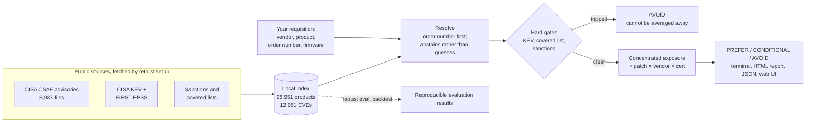

# ReTrust

**Score OT hardware for cyber risk before you buy it.**

ReTrust supports shortlist review before deployment. It answers a procurement
question: *of these candidate PLCs, which one
should we put on the purchase order?* It works entirely from public advisory
data, keys on the manufacturer order number a requisition already contains,
and shows the evidence behind every number it prints.

```
$ retrust compare \
    --candidate "ABB|AC 800M" \
    --candidate "Moxa|EDS-405A" \
    --candidate "Siemens|SIMATIC S7-1500|3.1.6" \
    --candidate "Hikvision|IP Camera"

  CANDIDATE COMPARISON ───────────────────────────────────────────────────────

  ABB AC 800M
  PREFER  ·  77.9/100
  CVEs 10  ·  ROBUST 85%

  Moxa EDS-405A
  CONDITIONAL  ·  64.6/100
  CVEs 10  ·  ROBUST 67%

  Siemens SIMATIC S7-1500 (firmware 3.1.6)
  AVOID  ·  50.9/100
  CVEs 942  ·  ROBUST gated
  Known exploited vulnerability

  Hikvision IP Camera
  AVOID  ·  no score
  ROBUST not sampled
  Named on a covered list

  AVOID: 2  ·  CONDITIONAL: 1  ·  PREFER: 1
```

## How it works



With a local installation, assessments run offline on your machine once
`setup` has fetched the sources. A hosted deployment processes assessment
queries on its server.

## Install and first score

Python 3.10+, no dependencies.

```bash
git clone https://github.com/MRALPHA20/retrust.git && cd retrust
python3 -m retrust.cli setup
```

Open the local browser workspace:

```bash
python3 -m retrust.cli serve
```

Visit **http://127.0.0.1:8765/** to search, assess by order number, compare
candidates with separate fields, and download HTML or JSON evidence. The
**guided demo** at `/demo` walks through the complete procurement workflow.
See the [live demo runbook](docs/demo-runbook.md) for a five-minute presentation.

For a hosted demonstration, use the included `render.yaml` Blueprint. See
[Deploy on Render](docs/render-deployment.md) for setup, data refresh behavior
and free-instance limits. Hosted assessments are processed on the server;
the local installation remains available for confidential procurement inputs.
The hosted interface is read-only and answers GET requests only: it serves
assessment queries and never exposes the commands that fetch data or change the
index.

Try the [hosted ReTrust demo](https://retrust-q2tr.onrender.com/) — a
free-tier instance that cold-starts in ~30 seconds and serves one request at a
time. For a live audience, run locally from a snapshot instead: same numbers,
no network.

To use the shorter `retrust` command below, install the CLI in a virtual environment:

```bash
python3 -m venv .venv
. .venv/bin/activate
python3 -m pip install -e .
```

Without installation, replace `retrust` with `python3 -m retrust.cli`.
Then score something from a real requisition:

```bash
retrust score --order-number 6ES7518-4AX00-1AB0 --version 3.1.6
```

You get a verdict, the pillar scores with the evidence behind each, and any
hard gate that fired — never a bare number. Add `--consequence`,
`--network-exposure`, `--interface` or `--remediation` to describe where the
equipment will actually live; left out, each stays unresolved rather than
guessed.

## Three ways to drive it

| | |
|---|---|
| `retrust score ...` | commands with flags, for engineers and pipelines |
| `retrust shell` | a menu that asks instead — no flags to remember, prints the equivalent command each time |
| `retrust serve` | the same assessments, timelines and RFQ annexes as pages on `127.0.0.1`, for whoever signs the purchase order |

Start with `retrust search <anything>` if you don't know the exact spelling —
misspellings return a shortlist instead of nothing.

### Interactive terminal

Run `python3 -m retrust.cli shell`. Type `search`, `score`, `order`, `compare`,
`vendor`, `batch`, `alternatives`, `lev`, `ssvc`, `diff`, `timeline`, `questions`,
`save`, or `quit`. The old numeric choices still work.

The terminal uses cyan section headings, verdict colors and pillar bars. Full
product names and evidence wrap to the terminal width. `save` exports the last
assessment as HTML, JSON or CSV; JSON retains its query for `diff` later.
`--no-color`, `NO_COLOR`, and redirected output keep the text free of ANSI colors.
Terminal background and fonts follow your terminal's own settings.

## Take a shortlist from review to a decision record

In the browser, **Compare candidates** accepts a manufacturer order number or
vendor/model for each row, plus optional firmware. Exact order-number searches
and **Compare this product** retain that identifier in the next assessment.

Download the complete comparison as HTML, JSON or CSV. HTML includes the ranked
results, original inputs, scoring weights and source provenance. JSON preserves
each query for later `retrust diff`; CSV includes query columns for spreadsheet
review. A mixed-firmware warning flags candidates assessed on different scopes.
Downloads are generated from the current local index when requested.

## Why order numbers, not CPE

In this local CISA OT corpus, 60 of 28,951 product entries carry CPE (0.21%).
Declared manufacturer order numbers occur on 8,211 entries (28.36%), about
137 times as many. This supports an order-number-led workflow for this dataset;
it does not measure other tools' performance.

## Accuracy, and how to check it

`retrust eval` recomputes every figure below from your own index — they are
measurements you re-run, not claims you accept:

| Measurement | Result |
|---|---:|
| Version ranges decided deterministically | 94.91% of 28,651 |
| ...of ranges that *can* be decided | 96.80% |
| Source-advisory recovery precision / recall (n = 4,000) | 99.85% / 99.70% |
| Hand-written buyer-query set (misspellings, shorthand) | 20/21 |

The round-trip measures whether the originating advisory is returned; it does
not count every extra match. Version coverage measures whether a range can be
parsed, not accuracy against independently labelled firmware cases.

The current historical backtest gives score versus later CVE disclosure rho
+0.342, falling to +0.212 within vendors and to -0.108 when Siemens is excluded.
These diagnostics do not validate prediction of compromise. See the
[benchmark report](docs/benchmark-report.md) for methods and limitations and the
[tool comparison](docs/tool-comparison.md) for official-source capability summaries.

Read the [illustrated PDF overview](docs/ReTrust-Guide.pdf) for the complete
explanation, worked example and measured results. Rebuild it with `make guide`
after installing the optional documentation dependencies: `pip install -e '.[docs]'`.

## Honest by design

- **Hard gates sit outside the weighted score** — a KEV hit or a covered-list
  match cannot be averaged away by good scores elsewhere.
- **The score is a product, not a mean** — `E^0.60 × P^0.20 × V^0.15 × C^0.05`,
  so dangerous exposure cannot be bought back with a good vendor record and a
  certificate. Exposure itself is concentrated on the worst findings rather than
  averaged across all of them.
- **You supply the plant facts, never a percentage** — ReTrust asks what a
  compromise would cost your process; it never asks you to score a vendor.
- **Raw CVE counts are never scored** — that would rank a diligent discloser
  below a silent one.
- **No resolution, no score** — every pillar reads "no CVEs found" as good
  news, so an unresolved product gets "needs review", not 100.
- **Unparseable version ranges stay in scope** — "could not decide" is never
  read as "not affected".
- **`retrust sensitivity` attacks the weights** — a verdict that survives
  fewer than 90% of random reweightings is flagged as a judgement call.
- **`retrust verify` checks the inputs** — SHA-512 digests and PGP signatures
  on all 3,937 advisories, with key discovery following the CSAF standard. The
  default never reads "could not check" as "verified"; `--strict` turns anything
  short of a positive result into a non-zero exit, for a pipeline that must not.

### Every command

| Command | |
|---|---|
| `retrust` | what the index holds, and what to try next |
| `shell` | interactive menu; no flags to remember |
| `serve` | a local web interface on 127.0.0.1 |
| `verify` | are the advisories the ones CISA published? |
| `setup` | fetch every source and build the index |
| `search QUERY` | find vendors, products or order numbers |
| `vendor NAME` | what the index holds on one manufacturer |
| `diff FILE` | re-score a stored result; what changed since |
| `alternatives` | other products in the same vendor family |
| `questions` | the RFQ security annex: what to ask the vendor, from the evidence |
| `timeline` | advisory history drawn as a shape: cadence, fix share, quiet time |
| `ssvc` | place findings on CERT/CC's SSVC deployer tree |
| `lev` | has this probably been exploited already? (NIST CSWP 41) |
| `score` | assess one product |
| `compare` | rank candidates for one decision |
| `batch FILE` | score a bill of materials or a CycloneDX SBOM, with a CI exit code |
| `vex` | write the assessment as a CycloneDX VEX document: SBOM in, VEX out |
| `cve CVE-...` | one CVE, everything the index knows about it |
| `sensitivity` | how much a verdict depends on the weights |
| `eval` | reproduce the accuracy figures, buyer-query set included |
| `backtest` | did the score predict later disclosure? `--sweep` for five cutoffs |
| `doctor` | is the installation current enough to be trusted right now? |
| `stats` | counts from the index |
| `config` | show or create the scoring weights; `--appetites` lists shipped risk appetites |
| `snapshot` | pin the data into one portable file |
| `ingest` | build the index from one or several CSAF directories |
| `provider URL` | fetch a vendor's own CSAF feed beside the CISA corpus |
| `refresh` | update the certification and sanctions lists |
| `screenshot` | render an HTML report to PNG |
| `demo` | run everything end to end |
| `completion bash\|zsh` | print a shell completion script |

## Learn more

- **[The manual](docs/manual.md)** — the scoring maths, the resolution ladder,
  the back-test design, the web UI's security posture, SSVC and LEV, and every
  design decision with the measurement that justified it.
- **[ReTrust-Guide.pdf](docs/ReTrust-Guide.pdf)** — an 11-page printable user
  guide that opens on a three-step quick start.
- **[docs/explainers/](docs/explainers/)** — three self-contained pages for
  explaining the tool to somebody else: [what it is and how it
  works](docs/explainers/overview.html), [every command by the job it
  does](docs/explainers/commands.html), and [the full scoring
  methodology](docs/explainers/scoring.html) with the formula worked through.
  Open any one in a browser; they cross-link.
- **[examples/](examples/)** — a candidate CSV, a CycloneDX SBOM, and the
  hand-written buyer-query benchmark.

Decision support, not a certification. Apache-2.0.
