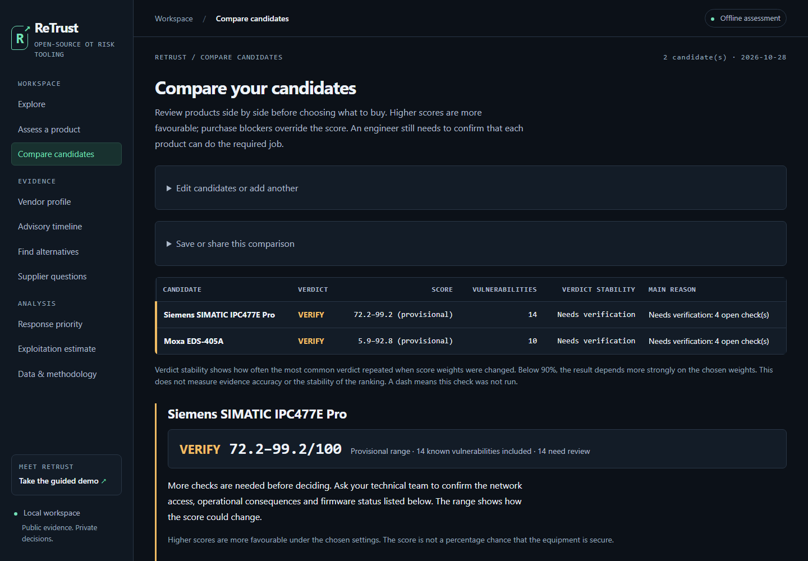

# ReTrust

**Cybersecurity evidence for OT hardware procurement.**

[](https://github.com/MRALPHA20/retrust/actions/workflows/tests.yml)
[](pyproject.toml)
[](LICENSE)
[](pyproject.toml)

ReTrust assesses industrial controllers, switches and other operational
technology (OT) products using public security advisories. Identify a product
by manufacturer order number or vendor/model, add firmware and operating
conditions, then review its score, recommendation and supporting evidence.

[Live demo](https://retrust-q2tr.onrender.com/) ·
[Documentation](docs/README.md) ·
[Scoring methodology](docs/explainers/scoring.html) ·
[Demo runbook](docs/demo-runbook.md) ·
[Contributing](CONTRIBUTING.md)



## What you can do

- Search products and manufacturer order numbers.
- Assess a product or compare a procurement shortlist.
- Review vulnerabilities, fixes, exploitation signals and supplier restrictions.
- Prepare supplier questions and export HTML, JSON, CSV or VEX evidence.
- Use the browser, command line or interactive terminal menu.

## Quick start

Requires **Python 3.10+** and Git. The application has no third-party runtime
dependencies. Initial setup downloads public sources; subsequent local
assessments can run offline using that snapshot.

```bash
git clone https://github.com/MRALPHA20/retrust.git
cd retrust
python3 -m retrust.cli setup
python3 -m retrust.cli serve
```

Open **http://127.0.0.1:8765/**. Search for a product, select **Assess a product**,
and supply the firmware and operating conditions you can verify.

For the terminal:

```bash
# Find a product or order number.
python3 -m retrust.cli search S7-1500

# Assess a specific product and firmware.
python3 -m retrust.cli score --order-number 6ES7518-4AX00-1AB0 --version 3.1.6

# Open the interactive menu.
python3 -m retrust.cli shell
```

Missing material inputs produce **VERIFY** and a provisional score range.
See the [command reference](docs/commands.md) for comparisons, exports and
installation of the shorter `retrust` command.

## How assessment works

1. Resolve the product and narrow the advisory scope using its firmware.
2. Check mandatory blockers, including applicable known-exploited weaknesses
   and configured supplier restrictions.
3. Calculate exposure and combine it with patch, vendor and certification
   evidence. Show the inputs, gaps and reasons behind the recommendation.

The current **RT8** model uses:

```text
Z = T × I × A × H × U
R = min(1, Z1 + 0.20 Z2 + 0.10 Z3)
E = 100 × (1 − R)
S = E^0.60 × P^0.20 × V^0.15 × C^0.05
```

`T` is the threat index: the strongest of KEV, LEV and EPSS, floored for the
equipment's service life by how the flaw is reached (wormable .50, other network
.30, local .15, physical .05). `I` is technical severity (CVSS base / 10), `A`
attack reachability, `H` credible operational impact, and `U` unresolved
applicability. The top three review units determine exposure. The other pillars
are patch capability (`P`), vendor practices (`V`) and certification evidence
(`C`). Network location is recorded as context; verified reachability
determines `A`. A missing patch, vendor or certification pillar keeps its
weight and contributes a neutral score of 50.

Default bands are **PREFER ≥80**, **CONDITIONAL 60–<80** and **AVOID <60**.
Mandatory blockers override the numeric band. Unresolved material evidence
produces **VERIFY**. A product with no usable evidence -- unidentified, or
named in advisories with no affected CVE -- is VERIFY across the full range,
with its conservative low end as the headline. A named firmware outside every
published affected range is different: the advisories say none of their CVEs
applies, so exposure is 100 and the patch and vendor record are still scored.
The verdict band reads the score as displayed, to one decimal.
Read the [full scoring explanation](docs/explainers/scoring.html) for unknown
inputs, grouping, floors, missing pillars and policy caps.

## Evidence and limits

Scores support a procurement review; they are not probabilities of compromise
or a certification. Source coverage, firmware matching and declared operating
conditions affect the result. The [benchmark report](docs/benchmark-report.md)
records measurements, their dates and their limits; the
[tool comparison](docs/tool-comparison.md) describes complementary capabilities.

A local installation processes assessments on your machine. The hosted demo
processes queries on its server and may take time to wake on the free plan.
See [Render deployment](docs/render-deployment.md) for configuration,
concurrency and build verification. Its
[formula validation](https://retrust-q2tr.onrender.com/formula-check.json)
reports checks against the deployed code and loaded data.

## Documentation

| Read | For |
| --- | --- |
| [User guide](docs/user-guide.html) | Browser and terminal workflows |
| [Commands](docs/commands.md) | CLI reference, exports and the `retrust` command |
| [Technical manual](docs/manual.md) | Matching, evidence handling, architecture and security |
| [Scoring methodology](docs/explainers/scoring.html) | The RT8 model with worked examples |
| [Benchmark report](docs/benchmark-report.md) | Measurements, dates and limits |
| [Tool comparison](docs/tool-comparison.md) | Scope alongside other security tools |
| [Demo runbook](docs/demo-runbook.md) | A five-minute presentation walkthrough |
| [Render deployment](docs/render-deployment.md) | Hosting, concurrency and release verification |

## Security

The server answers GET and HEAD only, writes nothing, runs no subprocess and
HTML-escapes every value it renders. Pages contain no JavaScript and load
nothing from any origin; every response carries a `default-src 'none'` content
security policy. It is intended for a local workstation and has no
authentication; do not expose it to an untrusted network. Report
vulnerabilities privately as described in [SECURITY.md](SECURITY.md).

## Repository layout

| Path | Contents |
| --- | --- |
| `retrust/` | Application, scoring engine, CLI and web interface |
| `tests/` | Automated regression tests and fixtures |
| `docs/` | Guides, methodology, benchmarks and presentation material |
| `examples/` | Sample candidate lists, bills of materials and buyer queries |
| `scripts/` | Deployment build and real-data smoke checks |
| `tools/` | Documentation builders, screenshot capture and benchmark utilities |
| `.github/` | Test workflow and contribution templates |

Downloaded sources, local databases, reports and caches are ignored by Git.
See [CONTRIBUTING.md](CONTRIBUTING.md) for setup, checks and file placement,
and [CHANGELOG.md](CHANGELOG.md) for notable changes.

Apache-2.0 — see [LICENSE](LICENSE).
