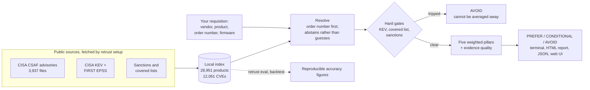

# ReTrust

**Score OT hardware for cyber risk before you buy it.**

Existing tools tell you about equipment you already own. ReTrust answers the
question a procurement team actually asks: *of these candidate PLCs, which one
should we put on the purchase order?* It works entirely from public advisory
data, keys on the manufacturer order number a requisition already contains,
and shows the evidence behind every number it prints.

```
$ retrust compare \
    --candidate "ABB|AC 800M" \
    --candidate "Moxa|EDS-405A" \
    --candidate "Siemens|SIMATIC S7-1500|3.1.6" \
    --candidate "Hikvision|IP Camera"

CANDIDATE                                 VERDICT       SCORE  CVES  ROBUST  NOTES
ABB AC 800M                               PREFER         82.2    10    93%
Moxa EDS-405A                             CONDITIONAL    56.1    10    77%
Siemens SIMATIC S7-1500 (firmware 3.1.6)  AVOID          39.8  1011   gated  Known exploited vulnerability
Hikvision IP Camera                       AVOID           --      -     -     Named on a covered list
```

## How it works



Everything runs offline on your machine once `setup` has fetched the sources.
Nothing you type ever leaves it.

## Install and first score

Python 3.10+, no dependencies.

```bash
git clone https://github.com/MRALPHA20/retrust.git && cd retrust
python3 -m retrust.cli setup
```

Then score something from a real requisition:

```bash
retrust score --order-number 6ES7518-4AX00-1AB0 --version 3.1.6
```

You get a verdict, five pillar scores with the evidence behind each, and any
hard gate that fired — never a bare number.

## Three ways to drive it

| | |
|---|---|
| `retrust score ...` | commands with flags, for engineers and pipelines |
| `retrust shell` | a menu that asks instead — no flags to remember, prints the equivalent command each time |
| `retrust serve` | the same assessments as pages on `127.0.0.1`, for whoever signs the purchase order |

Start with `retrust search <anything>` if you don't know the exact spelling —
misspellings return a shortlist instead of nothing.

## Why order numbers, not CPE

Measured across all 28,951 product entries in CISA's OT advisory corpus,
**60 carry a CPE string — 0.21%**. That is why conventional vulnerability
tooling is quiet about industrial gear. Manufacturer order numbers (Siemens
MLFB, Rockwell catalogue numbers) are **137× more available** and are what a
buyer types onto a requisition anyway. ReTrust keys on those.

## Accuracy, and how to check it

`retrust eval` recomputes every figure below from your own index — they are
measurements you re-run, not claims you accept:

| Measurement | Result |
|---|---:|
| Version ranges decided deterministically | 89.2% of 28,651 |
| ...of ranges that *can* be decided | 90.7% |
| Product resolution precision / recall (n = 4,000) | 99.9% / 99.7% |
| Hand-written buyer-query set (misspellings, shorthand) | 20/21 |

`retrust backtest` reports **against the tool's own interest**: the score
correlates *positively* with later disclosure volume (+0.453), because CVE
counts measure disclosure maturity, not risk. Hold the vendor constant and it
collapses to +0.157; drop the vendor that is half the sample and **+0.019 —
nothing** remains. `--sweep` shows the same pattern at five cutoffs. A scoring
tool that cannot show its own failure mode has not earned its verdicts.

## Honest by design

- **Hard gates sit outside the weighted score** — a KEV hit or a covered-list
  match cannot be averaged away by good scores elsewhere.
- **Raw CVE counts are never scored** — that would rank a diligent discloser
  below a silent one.
- **No resolution, no score** — every pillar reads "no CVEs found" as good
  news, so an unresolved product gets "needs review", not 100.
- **Unparseable version ranges stay in scope** — "could not decide" is never
  read as "not affected".
- **`retrust sensitivity` attacks the weights** — a verdict that survives
  fewer than 90% of random reweightings is flagged as a judgement call.
- **`retrust verify` checks the inputs** — SHA-512 digests and PGP signatures
  on all 3,937 advisories, with key discovery following the CSAF standard.

### Every command

| Command | |
|---|---|
| `retrust` | what the index holds, and what to try next |
| `shell` | interactive menu; no flags to remember |
| `serve` | a local web interface on 127.0.0.1 |
| `verify` | are the advisories the ones CISA published? |
| `setup` | fetch every source and build the index |
| `search QUERY` | find vendors, products or order numbers |
| `vendor NAME` | what the index holds on one manufacturer |
| `diff FILE` | re-score a stored result; what changed since |
| `alternatives` | other products in the same vendor family |
| `ssvc` | place findings on CERT/CC's SSVC deployer tree |
| `lev` | has this probably been exploited already? (NIST CSWP 41) |
| `score` | assess one product |
| `compare` | rank candidates for one decision |
| `batch FILE` | score a bill of materials or a CycloneDX SBOM, with a CI exit code |
| `sensitivity` | how much a verdict depends on the weights |
| `eval` | reproduce the accuracy figures, buyer-query set included |
| `backtest` | did the score predict later disclosure? `--sweep` for five cutoffs |
| `doctor` | is the installation current enough to be trusted right now? |
| `stats` | counts from the index |
| `config` | show or create the scoring weights |
| `snapshot` | pin the data into one portable file |
| `ingest` | build the index from a CSAF directory |
| `refresh` | update the certification and sanctions lists |
| `screenshot` | render an HTML report to PNG |
| `demo` | run everything end to end |
| `completion bash\|zsh` | print a shell completion script |

## Learn more

- **[The manual](docs/manual.md)** — the scoring maths, the resolution ladder,
  the back-test design, the web UI's security posture, SSVC and LEV, and every
  design decision with the measurement that justified it.
- **[ReTrust-Guide.pdf](docs/ReTrust-Guide.pdf)** — an 11-page printable user
  guide that opens on a three-step quick start.
- **[examples/](examples/)** — a candidate CSV, a CycloneDX SBOM, and the
  hand-written buyer-query benchmark.

Decision support, not a certification. Apache-2.0.
